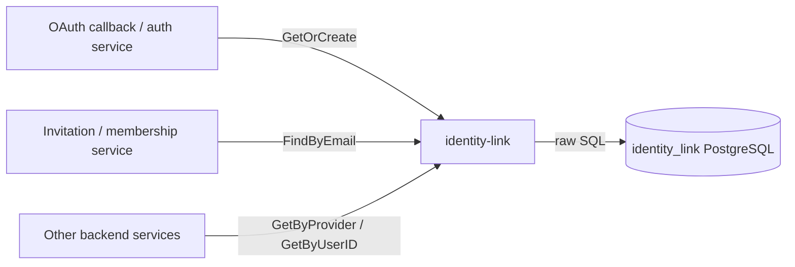
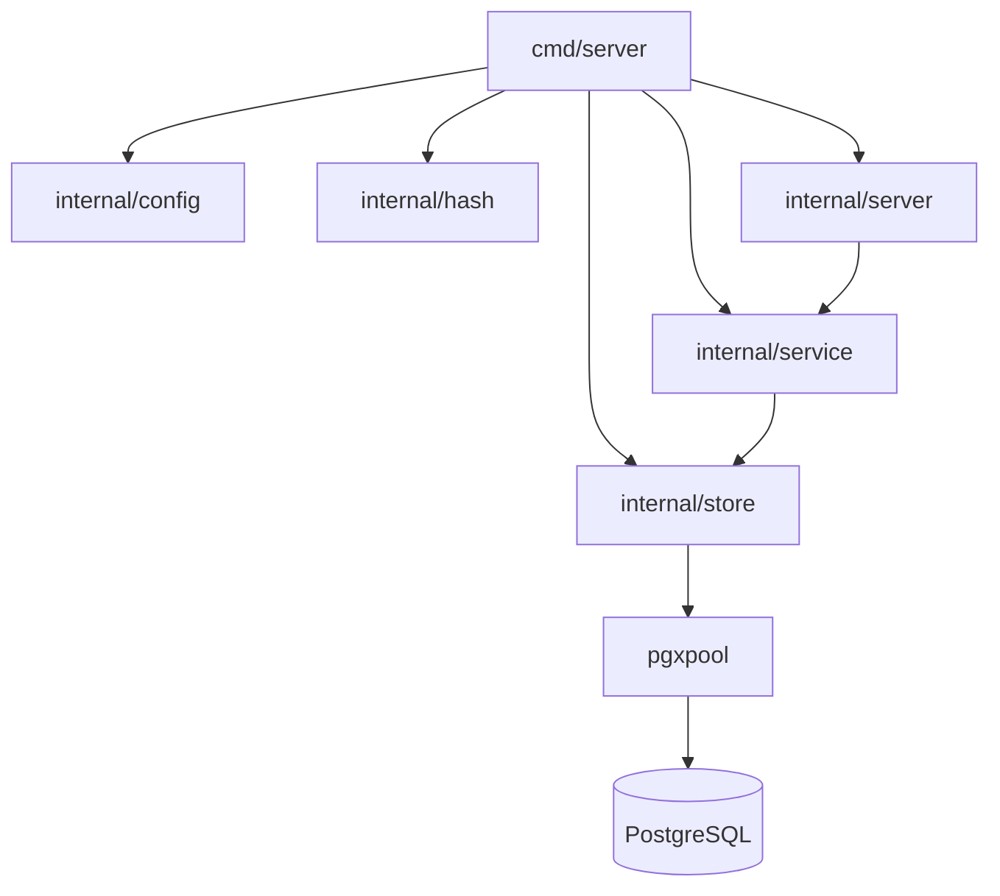
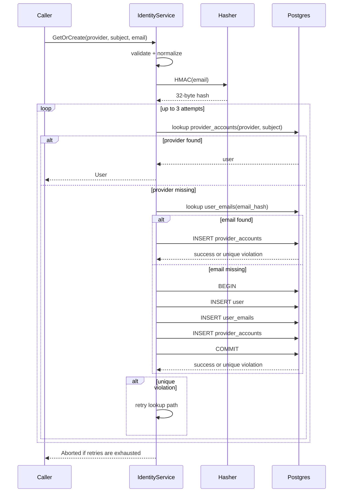

# Architecture

## Purpose

`identity-link` is the identity mapping authority for JiffyCRM. It answers three questions for the rest of the system:

1. Given an external provider identity, which internal `user_id` does it belong to?
2. Given an email, which internal `user_id` owns it?
3. Which external providers are attached to a given `user_id`?

The service deliberately does not perform OAuth/OIDC flows, issue sessions, or manage authorization. A caller completes the provider login, then calls this service.

## System context

All callers are backend services. There is no browser-facing endpoint in this service.

## Runtime components

| Component | Responsibility |
| --- | --- |
| `cmd/server` | Loads configuration, opens the pool, wires dependencies, serves gRPC, handles signals and graceful shutdown |
| `cmd/migrate` | Applies or rolls back embedded SQL migrations (`up` / `down`) |
| `internal/config` | Reads and validates environment variables; enforces a minimum HMAC secret length |
| `internal/hash` | Normalizes and validates emails; computes `HMAC-SHA256` hashes |
| `internal/store` | Defines the persistence interface, models, sentinel errors, and the pgx raw-SQL implementation |
| `internal/service` | Implements the gRPC handlers, input validation, normalization, and store-error mapping |
| `internal/server` | Builds the `grpc.Server`, registers the service, health, and reflection, installs interceptors, runs the DB health loop |
| `internal/migrate` | Embedded migration discovery, advisory locking, transactional apply/rollback |
| `migrations` | The versioned SQL schema |

Dependency direction is one-way: `cmd` → `internal/server`/`internal/service` → `internal/store`. The store knows nothing about gRPC; the service knows nothing about pgx types.

## Request lifecycle

Every unary RPC passes through:

1. Recovery interceptor: converts a panic into `codes.Internal` and logs it.
2. Logging interceptor: records method, status code, and duration. Request payloads are never logged.
3. Handler validation: provider, subject, email, and user ID are validated and normalized.
4. Store call: one or more parameterized SQL statements against PostgreSQL.
5. Response mapping: database rows become proto messages containing only IDs and timestamps.
6. Error mapping: sentinel store errors become stable gRPC status codes.

## GetOrCreate flow

`GetOrCreate` is the main write path. It must converge on one user under concurrent calls.

Key properties:

- The provider triple is checked first. If it exists, its linked user wins even when the supplied email hashes differently.
- The email path links a new provider to an existing user with that email.
- The create path writes all three rows in one transaction.
- PostgreSQL unique constraints (`provider_accounts(provider, provider_subject)` and `user_emails(email_hash)`) are the arbitration mechanism. No application-level locks are used.
- Any unique violation rolls back and restarts the lookup path. After three attempts the call returns `Aborted`.
- Under read-committed isolation, the conflicting transaction must commit or roll back before PostgreSQL raises the unique violation, so the retry sees committed rows.

## LinkProvider flow

`LinkProvider` explicitly attaches a provider to a known user:

1. Start a transaction.
2. Load the user. Missing user → `NotFound`.
3. Load `user_emails.email_hash`. Missing email row → `FailedPrecondition` (treated as a mismatch).
4. Compare the supplied hash with the stored hash. Mismatch → `FailedPrecondition`.
5. Insert `provider_accounts`.
6. On a unique violation: roll back, look up the triple owner.
   - Same user → return success (idempotent).
   - Different user → `AlreadyExists`.
7. Commit and return the user.

The email check prevents attaching a provider identity to an account that has a different email. The transaction ensures the check and insert are consistent.

## Unlink and lookup flows

`UnlinkProvider` deletes exactly the `(user_id, provider, provider_subject)` row. Deleting the last provider is allowed; the user remains resolvable by email. Removing a non-existent link returns `NotFound`.

`GetByProvider`, `GetByUserID`, and `FindByEmail` are single-statement reads. `FindByEmail` hashes the input before lookup. `ListProviders` first checks that the user exists, then returns provider rows ordered by `created_at, id`.

## Health and readiness

The standard `grpc.health.v1.Health` service is registered under the empty service name:

- Initial state: `NOT_SERVING`.
- A background loop pings the database immediately and then every 5 seconds with a 2-second timeout.
- Ping success → `SERVING`; ping failure → `NOT_SERVING` and a warning log.
- On shutdown, health status is set to `NOT_SERVING`.

A readiness probe should call the empty service. Liveness should reflect the process itself; the service fails fast at startup if the database is unreachable or configuration is invalid.

## Shutdown

`cmd/server` listens for `SIGINT` and `SIGTERM`.

1. Stop accepting new work via `grpc.Server.GracefulStop`.
2. Allow in-flight RPCs up to 10 seconds.
3. Force `Stop` after the timeout.
4. Close the database pool.

## Design decisions

| Decision | Rationale | Consequence |
| --- | --- | --- |
| Dedicated database per microservice | Prevents cross-service table access and schema coupling | Each deployment provisions `identity_link` DB and role |
| HMAC instead of plain SHA-256 | A DB dump alone cannot dictionary-attack hashes without the secret | Secret becomes a critical dependency; rotation is not transparent |
| Opaque UUID user IDs | No PII or provider data leaks through identifiers | Callers must call this service to resolve users |
| One email per user (`user_id` PK) | Matches v1 scope; simple uniqueness and lookup | Multiple-email support requires a migration and API change |
| Raw SQL, no ORM | Explicit queries, predictable locking and constraints | More hand-written scanning code |
| UUIDv7 generated in Go | Time-sortable IDs, no database extension required | IDs expose approximate creation time (acceptable here) |
| Unique constraints + bounded retry | Correctness under concurrency without distributed locks | Contended calls may return `Aborted` |
| Migration runner embedded in the binary | No external migration tool in deployment | Migrations run through a separate command, not at server startup |
| Reflection enabled | Fast local debugging with grpcurl | Should be disabled or network-restricted in production if policy requires |

## Known limitations

- No caller authentication, TLS/mTLS, or authorization. Deploy on a trusted network or add a transport-security layer.
- No HMAC key rotation or multi-key verification.
- No rate limiting, metrics, tracing, or audit log.
- No user deletion RPC and no soft deletes.
- No multi-email support and no email change flow.
- No provider allowlist; any well-formed provider string is accepted.
- `GetOrCreate` requires an email; there is no email-less user path.
