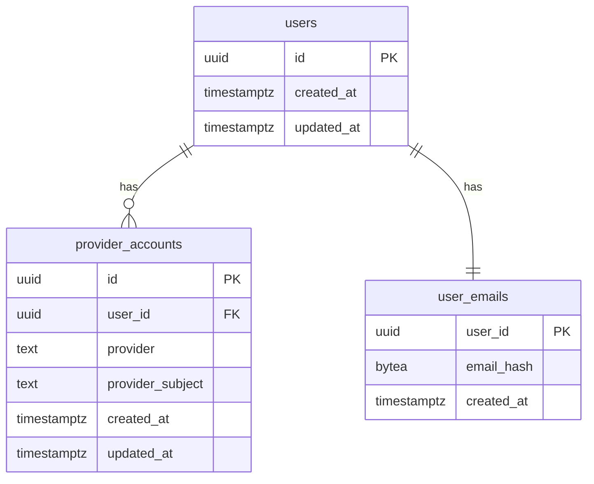

# Data Model

## Overview

`identity-link` owns one dedicated PostgreSQL database. It never reads or writes tables owned by other services.



Cardinality:

- One user has zero or more provider accounts. Zero is possible after unlinking every provider.
- One user has exactly one email row in v1.
- One email hash belongs to exactly one user.
- One `(provider, provider_subject)` pair belongs to exactly one user.

## Schema

### `users`

```sql
CREATE TABLE users (
    id         UUID PRIMARY KEY,
    created_at TIMESTAMPTZ NOT NULL DEFAULT now(),
    updated_at TIMESTAMPTZ NOT NULL DEFAULT now()
);
```

| Column | Notes |
| --- | --- |
| `id` | UUIDv7 generated by the service |
| `created_at` | Set by the database default |
| `updated_at` | Set at insert; no user update operation exists in v1 |

### `provider_accounts`

```sql
CREATE TABLE provider_accounts (
    id               UUID PRIMARY KEY,
    user_id          UUID NOT NULL REFERENCES users(id) ON DELETE CASCADE,
    provider         TEXT NOT NULL,
    provider_subject TEXT NOT NULL,
    created_at       TIMESTAMPTZ NOT NULL DEFAULT now(),
    updated_at       TIMESTAMPTZ NOT NULL DEFAULT now(),
    UNIQUE (provider, provider_subject)
);

CREATE INDEX idx_provider_accounts_user_id ON provider_accounts(user_id);
```

| Constraint | Purpose |
| --- | --- |
| Primary key on `id` | Unique provider link identifier |
| Foreign key `user_id` | Ownership; cascade delete if a user is removed directly in SQL |
| Unique `(provider, provider_subject)` | Prevents two internal users from claiming the same external identity; the race-safety arbiter |
| Index on `user_id` | Fast `ListProviders` and ownership checks |

`provider` is written in normalized form (trimmed, lowercased) by the service. The database does not enforce normalization because it is a service-layer rule.

### `user_emails`

```sql
CREATE TABLE user_emails (
    user_id    UUID PRIMARY KEY REFERENCES users(id) ON DELETE CASCADE,
    email_hash BYTEA NOT NULL UNIQUE,
    created_at TIMESTAMPTZ NOT NULL DEFAULT now()
);
```

| Constraint | Purpose |
| --- | --- |
| `user_id` primary key | Enforces at most one email row per user |
| Foreign key | Cascade delete with the user |
| Unique `email_hash` | Enforces one account per normalized email; the race-safety arbiter for email linking |

The table contains no plaintext email column and no email metadata such as domain, normalized address, or verification state.

### `schema_migrations`

The migration runner creates this bookkeeping table:

```sql
CREATE TABLE schema_migrations (
    version    BIGINT PRIMARY KEY,
    applied_at TIMESTAMPTZ NOT NULL DEFAULT now()
);
```

It is infrastructure, not domain data.

## UUID strategy

All IDs are generated in Go with `uuid.NewV7()`:

- Time-ordered, which keeps B-tree inserts local.
- No PostgreSQL extension is required.
- IDs reveal approximate creation time. This is accepted because IDs are opaque application identifiers, not secrets.
- In the improbable event UUIDv7 generation fails, the store falls back to UUIDv4.

## Email hashing

### Pipeline

1. Caller sends plaintext email in `GetOrCreate`, `FindByEmail`, or `LinkProvider`.
2. Trim leading/trailing whitespace.
3. Lowercase the full address.
4. Validate:
   - non-empty after normalization
   - at most 320 bytes
   - no internal whitespace
   - exactly one `@`
   - non-empty local part and domain
5. Compute `HMAC-SHA256(EMAIL_HMAC_SECRET, normalized_email)`.
6. Store the raw 32-byte digest in `user_emails.email_hash`.
7. Discard the plaintext with the request.

Identical normalized emails always produce identical hashes for a given secret. Different secrets produce unrelated hashes.

### Why HMAC instead of a plain hash

A plain SHA-256 of an email is vulnerable to offline dictionary attacks if the database leaks: an attacker can hash candidate addresses and match them. HMAC with a secret held outside the database prevents that attack unless the attacker also obtains the secret.

### Operational consequences

- The HMAC secret is as sensitive as the database. Losing it makes email lookup impossible for existing rows.
- Rotating the secret changes every email hash. There is no multi-key verification in v1, so rotation requires re-hashing emails, which the service cannot do because plaintext emails are not stored.
- Changing normalization rules in the future changes hashes as well and has the same migration problem.

### What is never stored or returned

- Plaintext email
- Email hash in any API response
- Email domain or local part
- Email verification status

## Transaction boundaries

### `GetOrCreate` create path

A single transaction inserts:

1. `users`
2. `user_emails`
3. `provider_accounts`

Any failure rolls back all three rows.

### `GetOrCreate` email-link path

Email lookup happens first, then a single `provider_accounts` insert. This is one write statement, so no explicit transaction is required. A concurrent conflict rolls back to the lookup loop.

### `LinkProvider`

One transaction:

1. Read the user.
2. Read the stored email hash.
3. Compare hashes.
4. Insert the provider link.

The unique violation path rolls back, then performs an owner lookup outside the transaction.

### `UnlinkProvider`

One `DELETE` statement. `rowCount == 0` is reported as `NotFound`.

## Concurrency model

The service uses PostgreSQL's default read-committed isolation and relies on unique constraints.

| Race | Resolution |
| --- | --- |
| Two calls create the same provider identity | One transaction wins; the other gets `23505`, retries, finds the provider, returns the winner's user |
| Two calls create the same email with different providers | One creates the user; the other gets `23505` on `user_emails`, retries, finds the email, attaches its provider to the same user |
| Two calls link the same provider to different users | One wins; the other gets `23505`, detects a different owner, returns `AlreadyExists` |
| Two calls link the same provider to the same user | One wins; the other gets `23505`, detects the same owner, returns success |

`GetOrCreate` retries at most three times. Persistent contention returns `Aborted`. No advisory locks or serializable isolation are used for domain writes.

## Migrations

### File layout

```text
migrations/
├── embed.go
├── 001_init.up.sql
└── 001_init.down.sql
```

Files are embedded into the binary. Names must match `NNN_name.up.sql` and `NNN_name.down.sql`. Versions are numeric and applied in ascending order.

### Runner behavior

`cmd/migrate up`:

1. Acquires the connection-scoped advisory lock.
2. Creates `schema_migrations` if absent.
3. Reads already-applied versions.
4. For each pending version, begins a transaction, executes the SQL, records the version, commits.
5. Releases the lock.

`cmd/migrate down` rolls back only the highest applied version.

Commands:

```bash
DATABASE_URL=... go run ./cmd/migrate up
DATABASE_URL=... go run ./cmd/migrate down
```

The server never applies migrations at startup. This prevents accidental schema changes during a rolling deploy and keeps startup behavior predictable.

### Adding a migration

1. Create `migrations/002_<description>.up.sql`.
2. Create `migrations/002_<description>.down.sql` with the inverse operation.
3. Keep the SQL transactional: avoid `CREATE INDEX CONCURRENTLY` unless the runner is changed accordingly.
4. Test `up`, `down`, and `up` again against a disposable database.
5. Update this document if tables or guarantees change.

## Data lifecycle

- There is no user-deletion RPC.
- There are no soft deletes.
- `UnlinkProvider` deletes provider rows immediately.
- Removing every provider leaves an orphan user that remains resolvable by email.
- Deleting a user directly in SQL cascades to `provider_accounts` and `user_emails`.
- Backups must include all three tables and must be protected like credential material because email hashes are present.

## Database privileges

Local development uses a single role that owns its dedicated database. For production, separate migration and runtime roles:

```sql
CREATE ROLE identity_link_owner LOGIN PASSWORD '...';
CREATE DATABASE identity_link OWNER identity_link_owner;

CREATE ROLE identity_link_app LOGIN PASSWORD '...';
GRANT CONNECT ON DATABASE identity_link TO identity_link_app;
GRANT USAGE ON SCHEMA public TO identity_link_app;
ALTER DEFAULT PRIVILEGES FOR ROLE identity_link_owner IN SCHEMA public
    GRANT SELECT, INSERT, UPDATE, DELETE ON TABLES TO identity_link_app;
```

Apply table grants after migrations, or set them for existing tables:

```sql
GRANT SELECT, INSERT, UPDATE, DELETE
    ON users, provider_accounts, user_emails
    TO identity_link_app;
```

Run migrations as `identity_link_owner`. Run the server as `identity_link_app`. The runtime role does not need access to other databases or schemas and does not need DDL rights.

## Direct database access policy

Only this service may read or write these tables. Other services must use the gRPC API. Queries that select `email_hash` outside the service are prohibited, and plaintext emails must never be written to the database.
